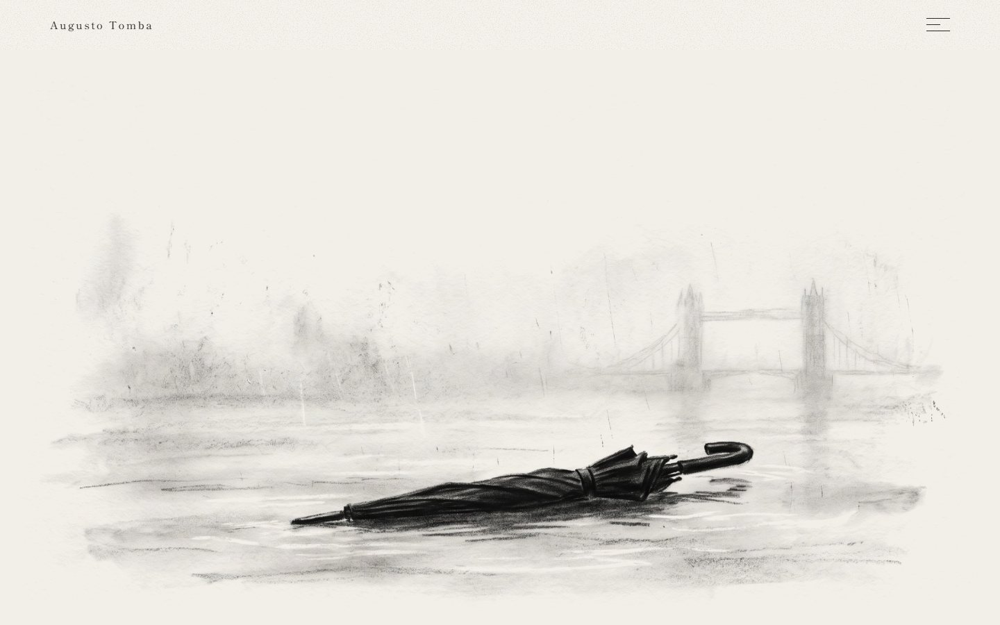
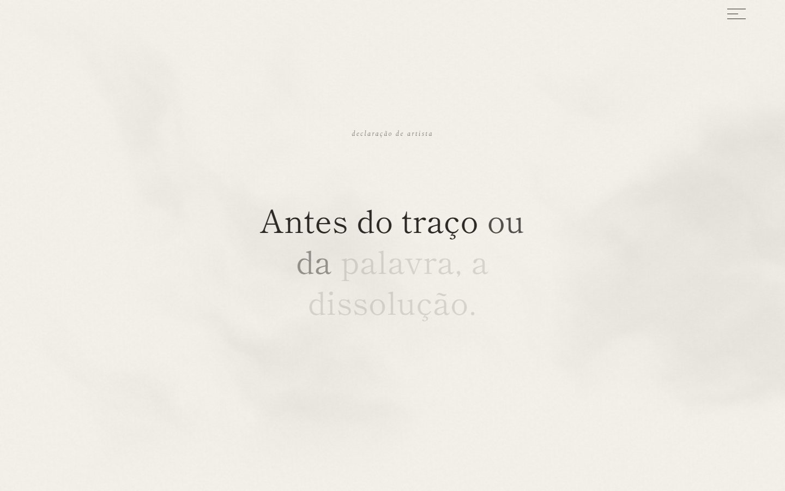
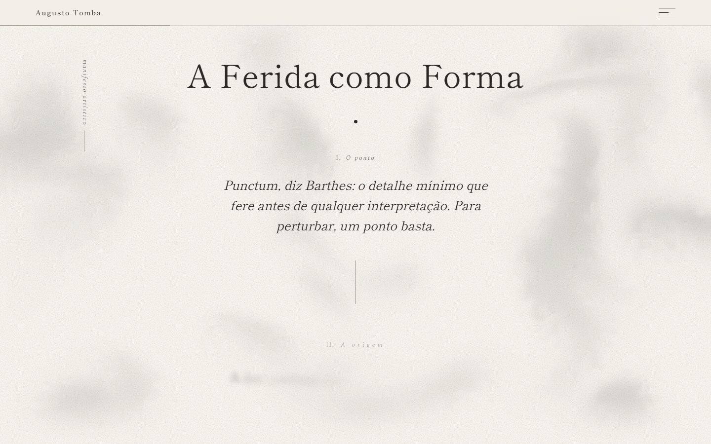
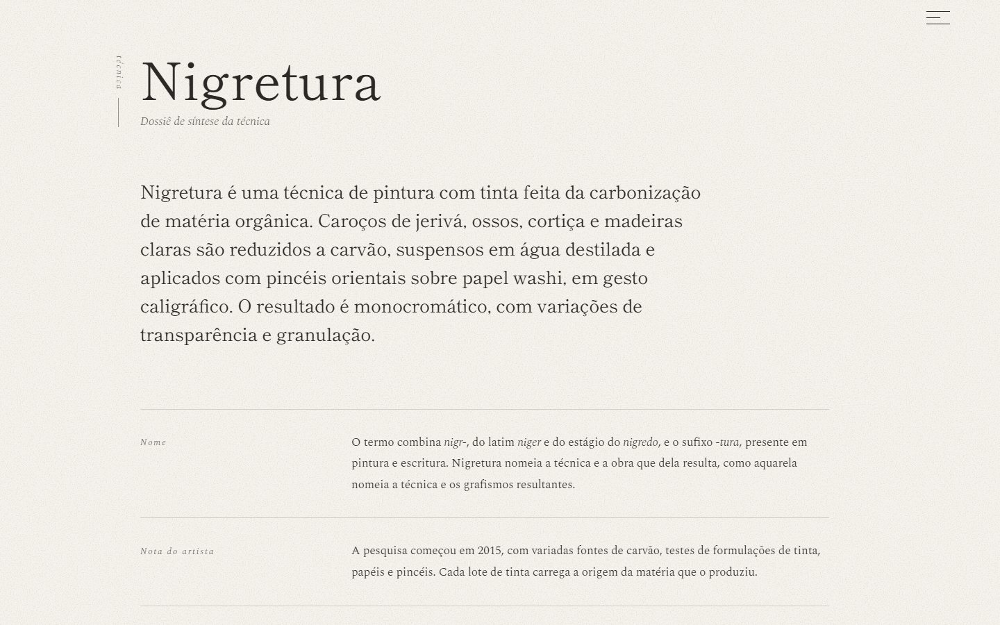
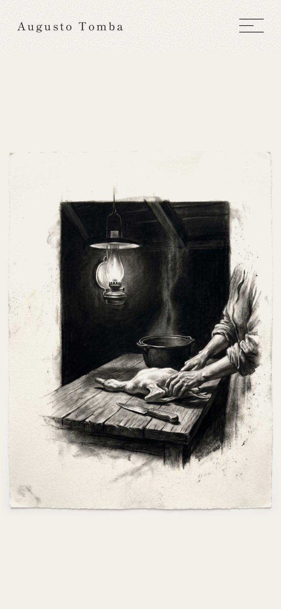
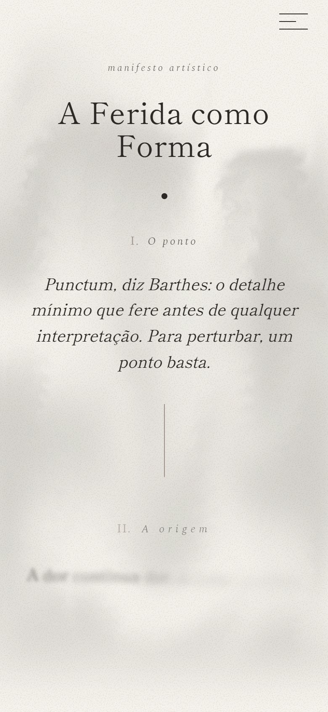
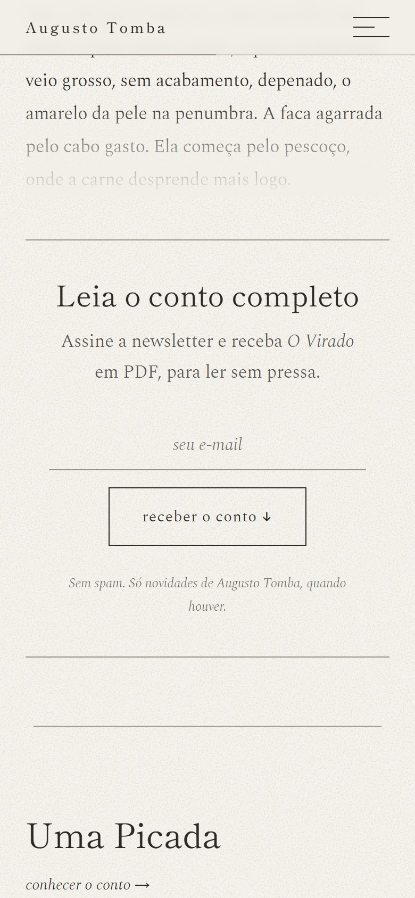

<div align="center">

# Augusto Tomba

*Antes do traço ou da palavra, a dissolução.*

Site do artista visual e escritor Augusto Tomba: pintura a carvão, a técnica Nigretura e contos.

**[Ver o protótipo →](https://alexandregarciajr.github.io/website-augusto-tomba/)** <sub>(esboço em aprovação, com textos e imagens provisórios)</sub>


</div>



## Sobre

**Augusto Tomba** vive em São Paulo. Pinta em carvão, têmpera de ovo e óleo, criou a **Nigretura** (uma técnica de pintura com tinta feita da carbonização de matéria orgânica) e escreve ficção.

O site reúne a obra dele em um só lugar: biografia, declaração de artista, o manifesto *A Ferida como Forma*, os contos, as coleções e a técnica. Ele foi pensado para parecer **papel**, não interface: fundo de papel com grão, tinta de carvão e muito espaço vazio.

Foi construído em etapas. Cada etapa termina com verificação em navegador real e screenshots em quatro larguras de tela.

Três regras guiam tudo:

- **O vazio é material.** O espaço em branco é parte da composição. A linha fina entre as seções, o *ma*, é a assinatura do site.
- **Movimento só quando serve ao conceito.** Os efeitos falam de dissolução, tinta e papel. Nada se mexe só para enfeitar.
- **Nenhuma cor.** A paleta é papel, tinta e um único cinza, usado só em traços finos.

## Direção visual

| | |
|---|---|
| **Paleta** | `#F2EFE9` papel · `#2B2825` tinta · `#9B9189` traço, usado só em linhas de 1px |
| **Tipografia** | Shippori Mincho nos títulos · Spectral light no texto |
| **Assinatura** | A linha de 1px entre as seções (o *ma*), que se desenha com a rolagem |
| **Navegação** | Sem barra de menu: três traços abrem o menu em tela cheia |
| **Inspiração** | Oriental: o rolo japonês, a caligrafia, o sumi-e e a pausa |

## O que tem no site

| Seção | O que acontece |
|---|---|
| **Abertura** | O nome sobre uma pintura. Ao rolar, a tela fica presa enquanto a pintura se dissolve em grão de carvão e as letras do nome se afastam. Sob o cursor, a imagem ondula como tinta em papel molhado |
| **Bio** | Retrato e apresentação, com o texto entrando palavra por palavra |
| **Declaração de artista** | Com a tela presa, a frase "Antes do traço ou da palavra, a dissolução." acende palavra por palavra, se dissolve, e no lugar dela surge a declaração. Fumaça de sumi se move ao fundo |
| **Manifesto** | *A Ferida como Forma*, em três movimentos. Um único ponto de tinta (o *punctum*) abre o texto, e cortes verticais finos se abrem entre as partes |
| **Literatura** | Os contos, cada um com página própria. Ao rolar, o título se desfaz letra a letra e o desenho do conto se forma em manchas de carvão. Depois vêm sinopse, primeiras linhas e o conto completo em PDF para quem assina a newsletter |
| **Coleções** | Texto de apresentação e um mosaico em que cada obra se revela em tinta ao entrar na tela. Uma legenda acompanha o cursor, a obra abre num lightbox e atravessa até a sua própria página |
| **Nigretura** | O dossiê da técnica: definição, nome, nota do artista, relação com a tradição, processo e diferenciação |
| **Rodapé** | O nome que se dissolveu na abertura volta a se compor, em traço fino, no fim da página |

## Destaques

**Shaders em WebGL puro, sem bibliotecas.** Quatro efeitos dividem o mesmo ruído de carvão:

- **Abertura:** a pintura se dissolve com a rolagem, com uma borda de tinta onde o papel aparece;
- **Declaração:** fumaça de tinta diluída se movendo atrás da frase;
- **Coleções:** um único canvas desenha uma folha de papel sobre cada obra e a desfaz quando ela entra na tela. Quando todas aparecem, o canvas sai de cena;
- **Contos:** o desenho é impresso no papel da página. O shader mede a cor do papel da própria imagem e a converte no papel do site, sem moldura.

**A rolagem conduz a narrativa.** Nas aberturas dos contos, a página não desce até o desenho estar formado. Cada gesto avança um pouco, com limite de velocidade, então rolar rápido não pula nada. Para cima, o efeito volta ao título. Em todo o site, mouse e trackpad ganham uma rolagem suave própria; no toque fica a rolagem nativa.



**Textos que entram como escrita.** Títulos e frases chegam palavra por palavra por máscara, imagens se descobrem como papel puxado, e a linha *ma* se desenha conforme a rolagem. Tudo com animações ligadas à rolagem (`animation-timeline`) e `IntersectionObserver`.

**A obra atravessa a página.** Do lightbox para a página da obra, a imagem viaja de um documento para o outro com *View Transitions*.





<p align="center">
  
  
  
</p>

## Feito com cuidado

| | |
|---|---|
| **Acessibilidade** | Todo efeito tem versão parada para quem pede "reduzir movimento" e versão estática sem WebGL. Tons de texto com contraste AA. Menu operável por teclado; lightbox com foco preso e devolvido ao fechar. Títulos animados letra a letra mantêm o nome inteiro como rótulo acessível |
| **Leve** | HTML, CSS e JavaScript puros, sem framework e sem bibliotecas de animação. Shaders com resolução limitada, que param fora da tela e se desligam quando terminam |
| **Mobile de verdade** | Layout próprio em cada largura, imagens verticais no celular, rolagem nativa no toque e nada de rolagem horizontal |
| **SEO** | Uma página por obra e por conto, título, descrição, Open Graph, `canonical`, dados estruturados (Person, CollectionPage, VisualArtwork, CreativeWork) e `sitemap.xml`, tudo gerado pelo build |
| **Texto fiel** | Os textos do artista entram exatamente como ele enviou. O que ainda falta fica entre colchetes, `[ assim ]`, para ninguém confundir rascunho com conteúdo |
| **Testado** | Regressão com Playwright em 1440, 1024, 768 e 390 px: erros no console, requisições quebradas, buracos no mosaico, rolagem horizontal e foco do lightbox |

**Tecnologias:**

- HTML, CSS e JavaScript, sem framework;
- WebGL com shaders GLSL próprios;
- CSS scroll-driven animations (`animation-timeline`) e View Transitions;
- um gerador estático em Node.js, sem dependências;
- [Playwright](https://playwright.dev) para os testes visuais;
- [GitHub Pages](https://pages.github.com) para publicar.

## Como funciona

O site é HTML puro, mas não é escrito à mão página por página. Um gerador pequeno (`build.js`, sem dependências) monta tudo a partir de modelos e dados:

```text
src/data/*.json ─┐
src/pages/*.html ├──► node build.js ──► index.html, quadros.html, livro.html
src/partials/    ┘                      obras/<obra>.html   (uma por obra)
                                        literatura/<conto>.html   (uma por conto)
                                        sitemap.xml
```

- **`src/data/obras.json`:** coleções, textos de apresentação e a ficha de cada obra;
- **`src/data/literatura.json`:** contos, com chamada, sinopse, imagens e o PDF;
- **`src/partials/`:** cabeçalho, menu, rodapé e lightbox, iguais em todas as páginas.

As páginas geradas ficam na raiz e são o que vai para o ar. **Não edite esses arquivos diretamente:** edite `src/` e rode o build de novo.

## Rodar localmente

```bash
node build.js
```

Depois sirva a pasta por HTTP. Abrindo o arquivo direto (`file://`), o navegador bloqueia as imagens nos shaders.

```bash
npx serve .
```

### Adicionar um conto

1. Acrescente uma entrada em `src/data/literatura.json` (título, chamada, sinopse e o texto em seções).
2. Coloque em `literatura/` a imagem vertical (`<conto>.jpg`, 3:4), a horizontal (`<conto>-larga.jpg`, 16:9) e o PDF (`<conto>.pdf`).
3. Rode `node build.js`. O card na home e a página do conto aparecem sozinhos.

### Adicionar uma obra ou coleção

Edite `src/data/obras.json` e rode `node build.js`. Cada obra ganha a sua página em `obras/`.

## Como foi construído

| Etapa | O que entregou | |
|---|---|---|
| **1. Revisão** | Revisão visual em quatro larguras de tela e correção do que estava quebrado | ✅ |
| **2. Base** | Transições, menu acessível, lightbox, contraste AA e mosaico sem buracos | ✅ |
| **3. Estrutura** | Gerador estático, página por obra, coleções, SEO e o nome como paisagem na abertura | ✅ |
| **4. Movimento** | A linha *ma* conduzindo as entradas, a obra atravessando a página e o nome se recompondo no rodapé | ✅ |
| **5. Shaders** | Dissolução da abertura, tinta sob o cursor, fumaça de sumi e obras se revelando em tinta | ✅ |
| **6. Literatura** | Contos com página própria, abertura guiada pela rolagem e download pela newsletter | ✅ |
| **7. Conteúdo do artista** | Manifesto, coleção com os textos revisados, as 7 obras, a Nigretura e a bio revisada | ✅ |

**Próximos passos:** fotos finais das obras e do artista, imagem definitiva da abertura, sinopses dos contos, newsletter ligada a um serviço real, endereços das redes sociais, o carimbo (hanko) do artista e as versões em inglês e espanhol.

## Estrutura

```text
├── src/                     fonte do site (edite aqui)
│   ├── data/
│   │   ├── obras.json       coleções e fichas das obras
│   │   ├── literatura.json  contos
│   │   └── site.json        nome, endereço e descrição
│   ├── pages/               home, quadros, livro e os modelos de obra e conto
│   └── partials/            cabeçalho, menu, rodapé e lightbox
├── build.js                 gerador estático (sem dependências)
├── styles.css               todo o visual: tokens, layout e animações
├── script.js                menu, reveals, lightbox, rolagem suave e newsletter
├── shaders.js               os efeitos em WebGL
├── literatura/              imagens e PDFs dos contos (+ páginas geradas)
├── obras/                   páginas geradas, uma por obra
├── index.html, quadros.html, livro.html, sitemap.xml   (gerados)
└── .github/                 imagens deste README
```

## Direitos

Projeto em desenvolvimento para Augusto Tomba. Os textos, as obras, os desenhos dos contos, o nome **Nigretura** e a identidade do artista têm todos os direitos reservados. As imagens da abertura são provisórias, de banco de imagens, e serão trocadas antes da publicação final.

---

<div align="center">

**Desenvolvido por Alexandre Garcia** · [alexandregarcia.dev](https://alexandregarcia.dev/)

[LinkedIn](https://www.linkedin.com/in/alexandregarcia-junior/) · [GitHub](https://github.com/AlexandreGarciaJr) · [E-mail](mailto:alexandregojunior@gmail.com)

</div>
